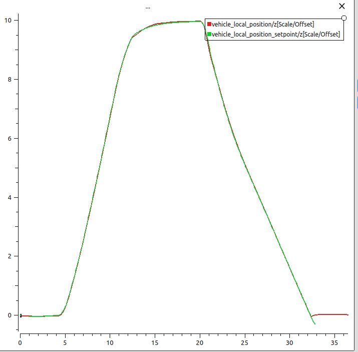

# Visual Follow-Me — Autonomous Drone Target Tracking

Vision-based target following for a PX4 multicopter: a camera feed is processed by
YOLOv8, a C++ ROS 2 controller turns the target's position in the image into velocity
setpoints, and PX4 executes them in Offboard mode. Developed and validated in
simulation (PX4 SITL + Gazebo), with a flight-test mindset: test plans, measured
latencies, log analysis and failure-mode checks.

> Personal project carried out during a gap year at CentraleSupélec to learn
> embedded computer vision, flight control architectures and C++.

## Status

**Phase 1 — Reading PX4 state: done.** A C++ node (`px4_monitor`) reads vehicle
status and local position from PX4 over uXRCE-DDS; flights are recorded with
rosbag2 and analysed in PlotJuggler. Next: safe Offboard control.




## Architecture

```
Webcam ──► detector_node (Python, YOLOv8n + ByteTrack)
                │  /target
                ▼
        follow_controller (C++, PID + state machine)
                │  /fmu/in/*  (Offboard setpoints)
                ▼
        MicroXRCEAgent ◄──► PX4 SITL (x500) ◄──► Gazebo Harmonic
                │  /fmu/out/* (vehicle state)
                ▼
        rosbag2 · PlotJuggler · QGroundControl (test & analysis)
```

## Tech stack

| Layer | Tools |
|---|---|
| Autopilot & simulation | PX4 (SITL), Gazebo Harmonic |
| PX4 ↔ ROS 2 bridge | uXRCE-DDS (MicroXRCEAgent), `px4_msgs` |
| Middleware | ROS 2 Humble |
| Control | C++17, `rclcpp` |
| Perception | Python, OpenCV, Ultralytics YOLOv8n (OpenVINO export for CPU) |
| Analysis | rosbag2, PX4 ULog, PlotJuggler, pyulog |

## Tested environment

| Component | Version |
|---|---|
| OS | Ubuntu 22.04 |
| ROS 2 | Humble |
| PX4-Autopilot | `main` @ `c4e4ef98e9` (v1.18.0-beta1-700) |
| px4_msgs | `6bcc947` (git submodule) |
| Gazebo | Harmonic (gz sim 8.15) |
| Hardware | Intel i7-6500U, 8 GB RAM, no dedicated GPU |
| Ground station | QGroundControl (Flatpak — the 5.x AppImages require glibc ≥ 2.36, not available on Ubuntu 22.04) |

PX4 `main` changes quickly: topic names are versioned (e.g. `vehicle_status_v4`)
and `px4_msgs` must match the PX4 build.

## Repository structure

```
├── src/
│   ├── fm_control/      # C++ control package (px4_monitor)
│   ├── px4_msgs/        # submodule, pinned to the PX4 version in use
│   └── fm_sandbox/      # C++ learning package (talker / listener)
├── scripts/
│   └── start_sim.sh     # MicroXRCEAgent + PX4 SITL in one command (tmux)
└── prototypes/python/   # early Python experiments (Offboard, waypoints, camera)
```

## Quick start

Prerequisites: ROS 2 Humble, PX4-Autopilot built for SITL (`make px4_sitl`),
Gazebo Harmonic, Micro XRCE-DDS Agent, tmux.

```bash
git clone --recurse-submodules git@github.com:jeanrouy/drone-cv-autonomous-tracking.git
cd drone-cv-autonomous-tracking
colcon build            # the first build of px4_msgs takes a while
source install/setup.bash

./scripts/start_sim.sh  # HEADLESS=1 ./scripts/start_sim.sh to run without the Gazebo GUI
ros2 topic list | grep fmu
```

## Roadmap

- [x] **Phase 0** — Simulation stack, repository, first C++ nodes
- [x] **Phase 1** — Read PX4 state from ROS 2 (C++ monitor node)
- [ ] **Phase 2** — Safe Offboard control: scripted flight, explicit state machine
- [ ] **Phase 3** — YOLOv8 detection, CPU optimisation (OpenVINO), latency benchmark
- [ ] **Phase 4** — Tracking (ByteTrack) and target lock logic
- [ ] **Phase 5** — Visual servoing controller (PID) with safety layers
- [ ] **Phase 6** — Test campaign: test plan, measurements, test report
- [ ] **Phase 7** — Demo video, closed loop with the simulated onboard camera

## Test approach

Each capability is validated against measurable criteria defined before testing
(e.g. Offboard entry time, failsafe reaction to controller loss, end-to-end latency,
centring error). Results, logs analysis and anomalies will be documented in `docs/`.

## Author

Jean Rouyère — engineering student, CentraleSupélec.